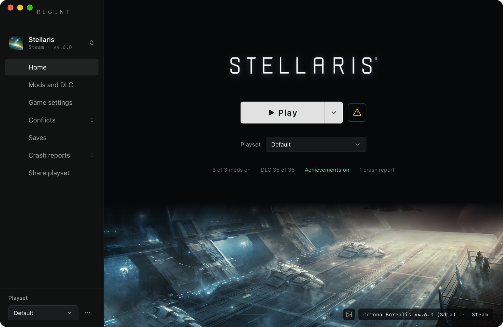

# Regent Launcher

A fast, native launcher and mod manager for Paradox grand strategy games, built with Rust and Tauri.



Regent replaces the official Paradox launcher. It finds your games, manages mods and DLC per playset, tells you whether achievements still work, and starts the game directly.

## Supported games

- Stellaris
- Crusader Kings III
- Hearts of Iron IV
- Europa Universalis IV

Installs are detected on Steam, GOG and the Xbox app. Only the games you have installed are listed.

## Features

- **Playsets.** Separate mod lists per game. Enable, disable, reorder by drag and drop, search, and toggle installed DLC. Regent writes the game's own `dlc_load.json` when you press Play.
- **Achievements check.** Shows live whether the current playset changes the game checksum, and which mods are responsible.
- **Conflicts.** Lists files that several enabled mods change, shows which mod wins, and suggests a better load order.
- **Saves bound to playsets.** Remembers which mods each save was made with, so you can load a save with the playset it needs instead of breaking it.
- **Game settings.** Edit resolution, language, audio and the rest of `pdx_settings.txt` without starting the game. Every write is backed up first.
- **Crash reports.** Reads the game's crash reports and points at the mods named in them.
- **Share playsets.** Export a playset as a share code, and import one after comparing it with your installed mods.
- **Looks like the game.** The official logo and background come from your game install. Each game gets an in-game wallpaper by default, and you can set your own (an image link, a wallhaven page or a local file). Mods without a preview image get one from the Steam Workshop.

## Install

Download the latest build from [Releases](../../releases/latest):

| Platform | File |
|---|---|
| macOS (Apple Silicon and Intel) | `.dmg` |
| Windows | `-setup.exe` |
| Linux | `.AppImage` or `.deb` |

Builds are not signed with a paid certificate, so your OS asks once on first launch:

- **macOS:** open the app once, then go to System Settings → Privacy & Security and click **Open Anyway**.
- **Windows:** when SmartScreen says "Windows protected your PC", click **More info** → **Run anyway**.

## Network use

Regent works offline. It goes online only for:

- the default wallpapers, from `wallhaven.cc`, downloaded once on first launch;
- preview images for Steam Workshop mods that have none on disk, from the Steam Web API.

App data (playsets, cached images) is stored in the system app data folder under `regent-launcher`.

## Build from source

Requirements: [Rust](https://rustup.rs) (stable), Node.js LTS, and pnpm 12. On Linux, also install the [Tauri system dependencies](https://v2.tauri.app/start/prerequisites/#linux).

```sh
pnpm install
pnpm dev        # run against generated fixture games
pnpm dev:real   # run against the games installed on this machine
pnpm release    # build the app and installer for this platform
```

Checks:

```sh
cargo fmt --check
cargo clippy --workspace --all-targets -- -D warnings
cargo test --workspace
pnpm typecheck && pnpm lint && pnpm build
```

Pushing a `v*` tag runs [the release workflow](.github/workflows/release.yml), which builds macOS, Windows and Linux and attaches them to a draft release.

## Project layout

| Path | What |
|---|---|
| `src/` | Rust library: game detection, mods, playsets, conflicts, saves, settings, crash reports, art |
| `src-tauri/` | Tauri app: commands and the `thumb://` image protocol |
| `app/` | React frontend |
| `scripts/` | Fixture generator for development |

## Disclaimer

Regent Launcher is a fan project and is not affiliated with or endorsed by Paradox Interactive. Game names, logos and icons belong to Paradox Interactive. Logos and backgrounds are read from your own game install; the sidebar icons are the games' Steam client icons.
